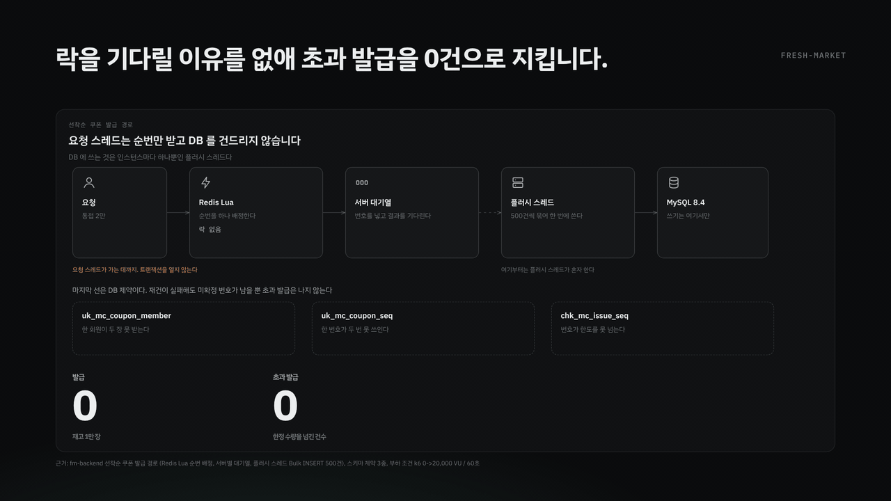
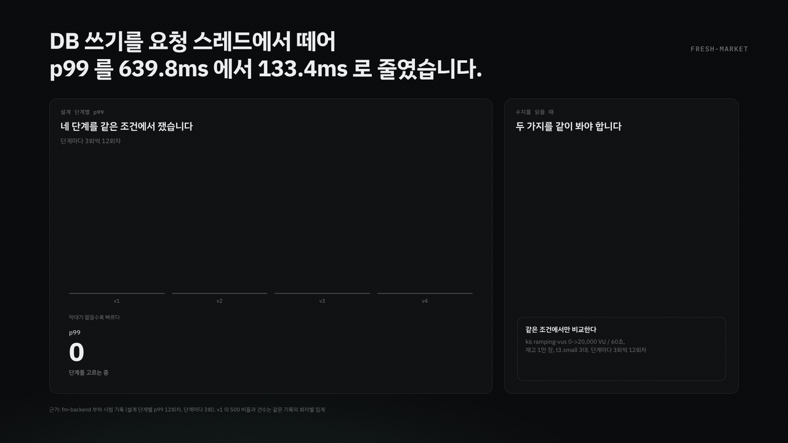
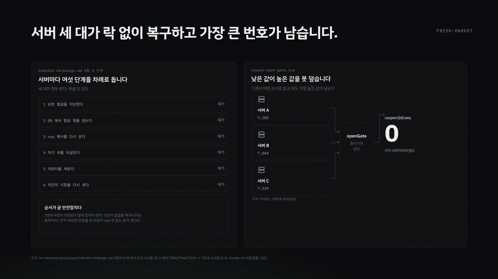
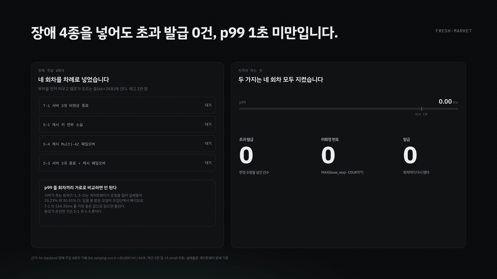

# 선착순 쿠폰 설계 동작

동접 2만 명 선착순 쿠폰 발급의 설계와 장애 복구를 애니메이션 네 편으로 설명합니다.

**웹에서 보기 -> https://devjohnpark.github.io/fm-coupon**

수치는 모두 [fresh-market/fm-backend](https://github.com/fresh-market/fm-backend)와
[fresh-market/fm-infra](https://github.com/fresh-market/fm-infra)의 부하 시험 기록과 설계 문서에서 가져왔습니다.
추정값이나 예시값은 쓰지 않았습니다.

| 항목 | 값 |
|---|---|
| 부하 | k6 ramping-vus 0 -> 20,000 VU / 60초 |
| 재고 | 1만 장 |
| 서버 | t3.small 3대 |
| 기간 | 2026.08 ~ 2026.09, 5인 팀 |

## 01 락을 기다릴 이유를 없애 초과 발급을 0건으로 지킵니다

요청 스레드는 Redis에서 순번만 받아 대기열에 넣고 결과를 기다립니다. DB에 쓰는 것은 인스턴스마다 하나뿐인 플러시 스레드입니다.
재고 행 하나를 깎지 않으니 기다릴 락이 없습니다. 한도를 지키는 것은 락이 아니라 번호입니다.

마지막 선은 DB 제약 셋입니다. `uk_mc_coupon_member`, `uk_mc_coupon_seq`, `chk_mc_issue_seq`.

## 02 DB 쓰기를 요청 스레드에서 떼어 p99 를 639.8ms 에서 133.4ms 로 줄였습니다

| 단계 | p99 |
|---|---|
| v1 | 639.8ms |
| v2 | 351.8ms |
| v3 | 355.8ms |
| v4 | **133.4ms** |

단계마다 3회씩 모두 12회차입니다.

> **v1 의 639.8ms 는 성능 수치가 아닙니다.** 그 회차는 요청의 약 80%가 500으로 끝나 임계를 깼습니다.
> 답을 못 받은 요청이 모집단에서 빠지므로 지연만 떼어 읽으면 틀립니다. 비교의 출발점으로만 씁니다.
>
> **v3 는 지연을 줄이지 않았습니다.** 351.8ms에서 355.8ms로 오히려 늘었습니다.
> 단계를 하나 더 둔다고 저절로 빨라지지 않는다는 것을 그 회차가 보여 줍니다.

## 03 서버 세 대가 락 없이 복구하고 가장 큰 번호가 남습니다

Redis가 키를 잃으면 카운터가 사라져 번호가 1번부터 다시 나갑니다. 이미 번호를 쥔 회원에게 같은 번호가 또 갑니다.

어떤 티켓이 메모리 대기열에 있었는지는 그 서버만 압니다. 한 대에게 전체를 맡기면 나머지 두 대의 대기열이 통째로 사라집니다.
그래서 세 대가 각자 자기 몫만 합니다.

락을 안 걸어도 되는 까닭은 카운터를 세우는 Lua가 **올리기만** 하기 때문입니다.
낮은 값이 높은 값을 못 덮으므로 어떤 순서로 읽고 써도 가장 높은 값이 남습니다.
한 회차에서 7,200과 7,044와 7,234가 들어와 7,234가 남았습니다.

> **멈춘 시간 1.88초의 대부분은 재건이 아닙니다.** 마지막 서버가 끝난 뒤 차단이 시한 1초에 저절로 풀리는 시간이 함께 들어 있습니다.
> 서로 기다리지 않게 한 대가로 치른 1초입니다.

## 04 장애 4종을 넣어도 초과 발급 0건, p99 1초 미만입니다

부하를 먼저 띄우고 램프가 오르는 중(k6+24초)에 장애를 걸었습니다.

| 회차 | 발급 | 미확정 번호 | 초과 발급 | p99 | 실패율 |
|---|---|---|---|---|---|
| T-1 서버 1대 비정상 종료 | 10,000 | 0 | 0 | 134.35ms | 25.23% |
| S-1 캐시 키 전부 소실 | 10,000 | 0 | 0 | 535.50ms | 0.00% |
| S-4 캐시 Multi-AZ 페일오버 | 9,642 | 5 | 0 | 973.67ms | 0.00% |
| S-3 서버 1대 종료 + 캐시 페일오버 | 9,723 | 0 | 0 | 569.75ms | 30.31% |

> **p99 를 회차끼리 가로로 비교하면 안 됩니다.** 서버가 죽는 회차(T-1, S-3)는 ALB가 죽은 인스턴스를 대상 그룹에서
> 빼기까지 몇 초가 걸리고 그동안 그쪽으로 간 요청이 끊깁니다. 답을 못 받은 요청이 모집단에서 빠지므로
> T-1의 134.35ms를 가장 좋은 값으로 읽으면 틀립니다. 분모가 온전한 것은 S-1과 S-4뿐입니다.
>
> **미확정 번호 0 은 장애를 포함해 주장하지 않습니다.** S-4 회차에 5개가 남았습니다.
> 장애를 포함해 말할 수 있는 것은 초과 발급 0과 1인 1매와 p99 1초 미만 셋입니다.
